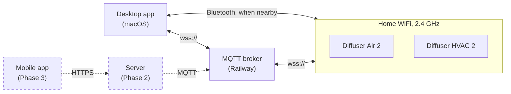
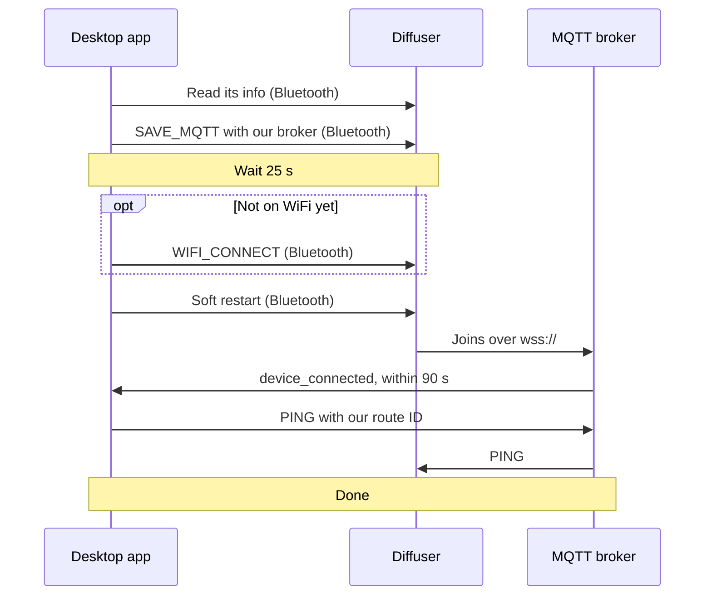
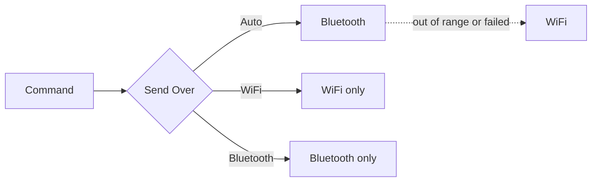

# Scent Control

A self-hosted app and server for Scentiment smart diffusers. It sets them up on your
WiFi, controls them, and runs their schedules without Scentiment's cloud.

> **Status:** the macOS desktop app sets up and controls the Diffuser Air 2 and
> HVAC 2, over Bluetooth and over WiFi through our own MQTT broker. The owner is
> testing it on the real diffusers now. There is no server or mobile app yet.

## Why

Scentiment's official app has to reach Scentiment's servers before it will set up or
control a diffuser. The app is not reliable also I wanted something to work with other brand and possibly HomeKit support.

## Where it stands

| Phase | What | Status |
|---|---|---|
| 0 | Prove it on the real devices: Bluetooth control, moving a diffuser to our broker, schedules on the device | Done (gate: go) |
| 1 | The macOS desktop app, talking to the diffusers and our test broker directly | Built. The owner's test session is under way |
| 2 | The server and production broker (a login per diffuser, desired state), HVAC 2 schedules, power-cut and button tests | Planned |
| 3 | The mobile app, then accounts, homes and testers | Planned |

## Supported devices

| Device | Bluetooth | WiFi, through our broker |
|---|---|---|
| Scentiment Diffuser Air 2 | Yes | Yes |
| Scentiment Diffuser HVAC 2 | Yes | Yes (schedules not tested yet) |

Both were tested on firmware 2.30. On that firmware neither reports its oil level or
accepts light commands, so the app doesn't offer them. The Scent Diffuser Pro 2 is a
different device and hasn't been tested. Other brands may follow later.

## How it works

The diffusers sit on your home WiFi and connect out to our MQTT broker, a Mosquitto
server on Railway, over `wss://`. The desktop app talks to a diffuser directly over
Bluetooth when it's nearby, and through the broker otherwise. Schedules are stored on
the diffuser and run there, so they keep running when the app is closed. Dashed boxes
are planned.



### Adding a diffuser

The app moves a diffuser onto our broker over Bluetooth. If it isn't on WiFi yet, the
app first asks for the network name and password. They go to the diffuser once and
are never kept.



The app always waits the full 25 s after `SAVE_MQTT`. In that time the diffuser makes
a test login with the new credentials and announces itself on the broker, which could
pass for a successful restart. If `device_connected` doesn't come within 90 s of the
restart, the add stops and says what to check: the WiFi password, that the network is
2.4 GHz, and that the diffuser is in range of the router.

### Sending a command

Each diffuser has a **Send Over** choice.



Auto tries Bluetooth first and falls back to WiFi. After Bluetooth fails to reach a
diffuser, Auto skips it for 2 minutes, unless the diffuser is heard over Bluetooth
again. WiFi and Bluetooth send only that way, with no fallback.

## Development

This is a Bun + Turborepo monorepo. The Rust crates are members of the Cargo workspace
at the repo root, and the Python tools live in `tools/`. You need Bun, a Rust toolchain
and Python 3.11 or newer.

```sh
bun install
bunx turbo run build test lint fmt:check
```

That one command builds, tests, lints and format-checks every package, including the
Python tools' tests (it creates `tools/.venv` on first run).

## Desktop app

`apps/desktop` is a native macOS app (Rust, eframe/egui). It is macOS only.

Build and launch it as an app bundle:

```sh
scripts/bundle-macos.sh
open "target/Scent Control.app"
```

Always launch it with `open`, never by running the binary directly. macOS kills any
process that uses Bluetooth unless the app responsible for it declares a Bluetooth
usage description in its Info.plist, and only the bundle has one. The script builds a
release binary, assembles `target/Scent Control.app` and signs it ad hoc.

On first launch, open Settings (⌘,) and type the broker password once. The app keeps it
in the macOS Keychain and nowhere else. The first Bluetooth scan brings up macOS's
Bluetooth permission prompt. A diffuser accepts one Bluetooth connection at a time, so
close Scentiment's app, or turn your phone's Bluetooth off, while you use this one.

## Docs

- [docs/releases.md](docs/releases.md): independent component versions and Git tags.
- [docs/findings.md](docs/findings.md): what we know about the devices and their
  protocol, with dates and sources.
- [The design](docs/superpowers/specs/2026-10-20-scent-control-design.md): goals,
  architecture and phases.
- [docs/phase-1-owner-session.md](docs/phase-1-owner-session.md): the hands-on test
  of the desktop app on the real diffusers.

## Acknowledgements

[Scent Assistant](https://github.com/mr-sparks/scent-assistant) (MIT) documented the
Scentiment Bluetooth protocol first.

## Disclaimer

This project is not affiliated with or endorsed by Scentiment. "Scentiment" is used
only to name the devices this project works with.

## License

[MIT](LICENSE)
